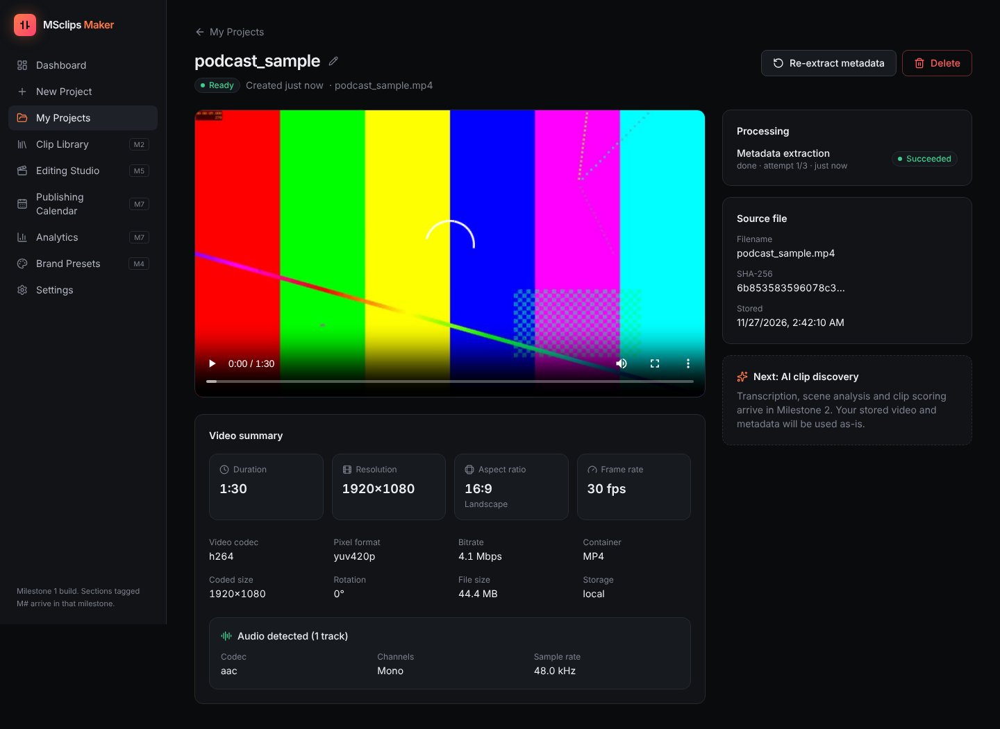
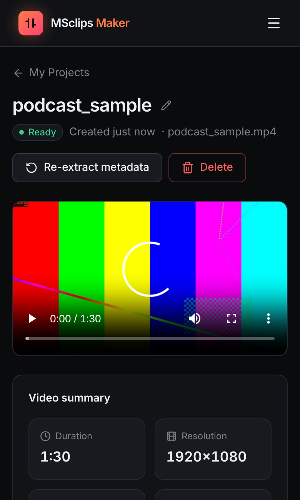

# MSclips Maker

**Demo cepat (satu perintah, butuh Docker):** `docker compose up --build`, lalu buka http://localhost:3000. Panduan lengkap: [docs/DEMO.md](docs/DEMO.md).

AI video repurposing platform: one long video in, professionally edited vertical shorts out
(TikTok, Instagram Reels, YouTube Shorts). Built milestone by milestone. Nothing in the UI is
simulated: a feature is either real or clearly marked as arriving in a later milestone.

**Plan & design:** [`docs/ARCHITECTURE.md`](docs/ARCHITECTURE.md)

## Status

| Milestone | Scope | State |
|---|---|---|
| 1 | Dashboard, upload, metadata, storage, project persistence | **done** |
| 2 | Transcription, scene analysis, AI clip discovery, scoring | next |
| 3 | Smart cutting, vertical reframing, subtitle engine | planned |
| 4 | Animation, B-roll, audio enhancement | planned |
| 5 | Editing studio, preview, timeline, regeneration | planned |
| 6 | Render engine, export, QC, batch processing | planned |
| 7 | TikTok / Instagram publishing | planned |

### Milestone 1 delivers
- Resumable chunked upload (8 MB chunks, 3 in parallel, per-chunk retry with backoff,
  cancel, resume after network failure or page reload by re-selecting the file).
- Server-side ingest in a background worker: size check, SHA-256, move to storage,
  `ffprobe` metadata (duration, resolution, rotation-aware display size, FPS, aspect ratio,
  codecs, bitrate, audio tracks/channels/sample rate), a real frame-decode check, thumbnail.
- Clear failure handling: corrupt or audio-only files fail fast with a readable reason;
  transient errors (storage/network) retry with backoff; queue outages are surfaced and retryable.
- Projects: list, search, status filter, pagination, rename, delete (removes stored files),
  re-extract metadata, video playback with HTTP Range.
- Dashboard with real counts, footage duration, storage used, active jobs.
- Settings page with live health checks (DB, Redis queue, storage, FFmpeg).
- Local filesystem or S3-compatible storage (MinIO / R2 / S3).

<p>


</p>

## Stack
Next.js 16 + Tailwind v4 (`apps/web`) · FastAPI + async SQLAlchemy + Alembic (`backend`) ·
arq workers on Redis · PostgreSQL 16 · FFmpeg · local or S3-compatible storage.

## Run locally

Requirements: Python 3.12+, [uv](https://docs.astral.sh/uv/), Node 22, FFmpeg on `PATH`,
and PostgreSQL + Redis (or Docker for `make infra`).

```bash
make infra             # postgres, redis, minio via docker compose
make backend-install
make migrate
make api               # http://localhost:8000/docs
make worker            # in another terminal
make web-install
cp apps/web/.env.example apps/web/.env.local
make web               # http://localhost:3000
```

Configuration is via `MSCLIPS_*` environment variables (see `backend/.env.example`).

## Tests

```bash
createdb -U msclips msclips_test     # once
make test                                 # 17 backend tests (real Postgres + real ffmpeg) + lint/typecheck
make e2e VIDEO=/path/to/video.mp4         # browser smoke test against the running stack
```

The browser smoke test covers: invalid-file rejection, real upload, redirect only after server
confirmation, metadata shown after the worker finishes, cancel mid-upload, network failure +
resume, and mobile layout.

## Content rights
Only process videos you own or have permission to repurpose.
